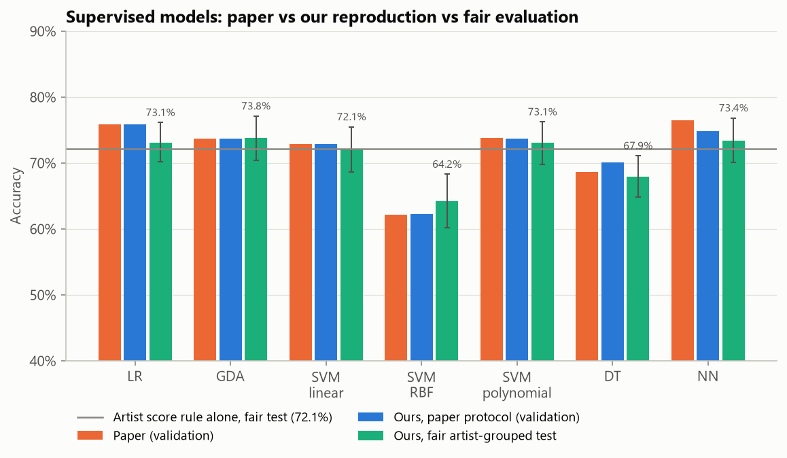
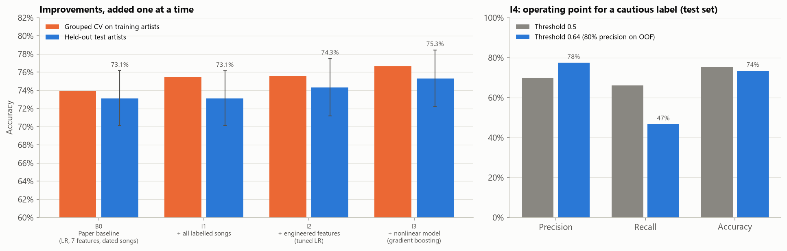
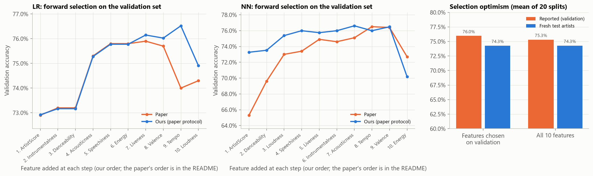
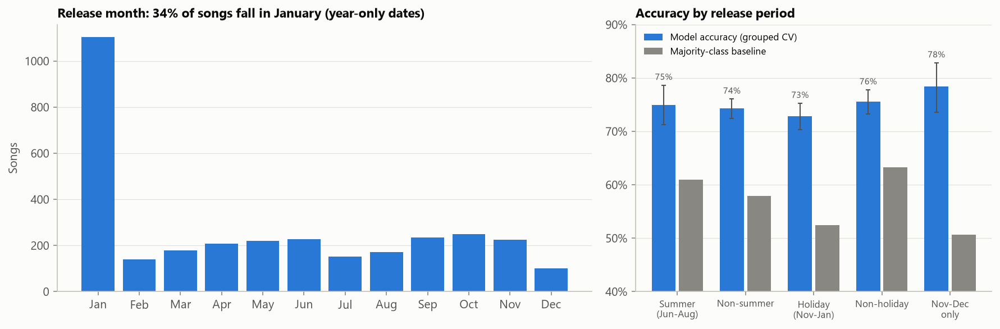
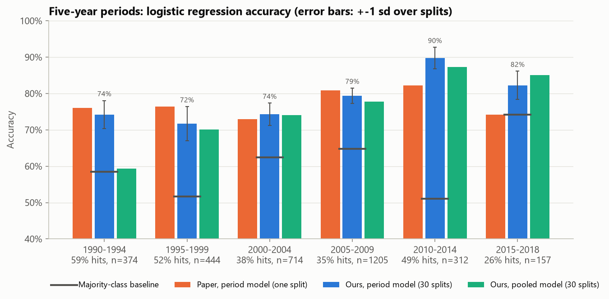
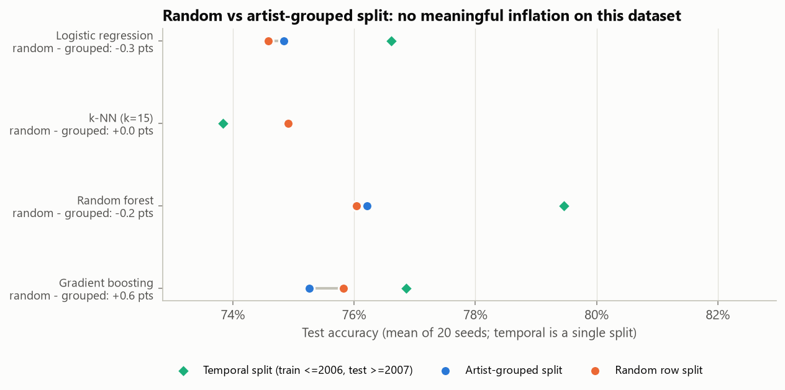
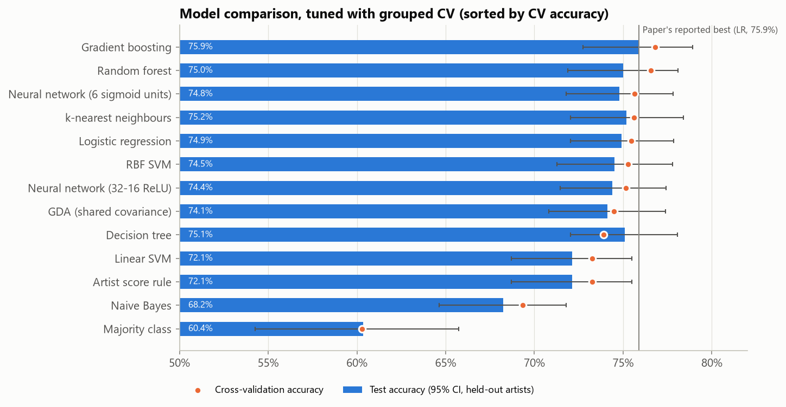

# HitPredict, reproduced and extended

UE24CS352A Machine Learning mini-project, problem 16.

Can Spotify audio features predict whether a song reaches the Billboard Hot 100? This repository
reproduces the reference paper

> E. Georgieva, M. Suta, N. Burton. *HitPredict: Predicting Hit Songs Using Spotify Data.*
> Stanford CS229 final project, 2018 (also ICML 2020 Machine Learning for Media Discovery workshop).

re-evaluates it with a fair protocol, compares a range of tuned models and adds improvements of
our own.

## Results at a glance

All "fair" numbers are on one fixed held-out test set: 1,004 songs by 25% of lead artists, none of
whom appear in training. Every model choice was made with 5-fold artist-grouped cross-validation on
the training artists. 95% confidence intervals come from resampling whole artists.

| | Accuracy | Notes |
|---|---|---|
| Paper, best model (LR, validation set) | 75.9% | validation set also used to pick the features |
| Our reproduction of the paper's LR, same protocol | 75.9% | identical, down to the confusion matrix (225/122/72/386) |
| Paper's LR under the fair protocol | 73.1% [70.1, 76.2] | |
| Artist score alone ("hit if the artist had a hit before") | 72.1% [68.7, 75.5] | no audio at all |
| Our best model: gradient boosting, 12 features (I3) | **75.3%** [72.2, 78.5], ROC AUC 0.837 | +2.2 points over the paper's LR on the same test songs |
| Best single model in the comparison: gradient boosting, 10 paper features | 75.9% [72.7, 78.9], ROC AUC 0.836 | |
| Majority class | 60.4% | |

The main findings:

1. **The paper reproduces.** On the authors' own data with their split, LR, GDA and all three SVMs
   match the paper's Table 2 to the third decimal. The RBF and polynomial SVMs match only after
   restoring scikit-learn 0.20's definition of `gamma="scale"` (1/(n_features * X.std()); later
   versions use `X.var()`). The decision tree is within 1.4 points and the neural network within 1.6.
2. **Several of the paper's conclusions come from scoring bugs in the authors' code**, which we
   reproduce exactly and then correct:
   * *"SVMs overfit"*: the SVM training accuracies (0.550 / 0.573 / 0.543) compare an (m, 1) array
     with an (m,) array, so numpy broadcasts to an m-by-m matrix. The real training accuracies are
     0.721 / 0.642 / 0.735, at or below validation. There is no overfitting.
   * *"Unsupervised EM gives 50.1%, semi-supervised 46.9%"*: the same broadcasting bug. The real
     accuracies are 62.6% and 68.5% (majority class 58.6%), so the clusters do carry signal.
   * *Bagging tables (decision tree as low as 2.7%)*: the vote fractions are averaged and then
     compared with `==` to the 0/1 label, so a song counts as correct only when every bag agrees.
     Real majority-vote accuracy is 72-76% in every configuration.
3. **The paper used its validation set to make choices and then reported that same validation
   score.** It used it for feature selection, the NN epoch, the tree depth and the bagging setup
   ("an additional test set was not needed"). Over 20 artist-grouped splits, picking features on
   validation overstates accuracy by 1.7 points (76.0% reported vs 74.3% on fresh artists),
   against 1.0 points with no selection. For the NN, picking the epoch by peeking gives 74.6% vs
   73.6% for an epoch chosen on an inner validation split.
4. **Splitting by artist barely changes the score here.** Even though 56% of the paper's
   validation songs have the same artist in training, a random split inflates accuracy by only
   -0.3 to +0.6 points across four models (20 seeds each, seed-to-seed spread about 1 point). The
   artist information that matters is already in the artist score, which is a legitimate input on
   both sides. We still report everything on the artist-grouped split because it is the honest
   protocol for "a song by a new artist".
5. **Audio adds only about 3-4 points over the artist score alone.** All 11 learned models land
   between 68% and 76% on test. The task is hard to push much further with these 12 features, and the
   gradient-boosting gain over plain logistic regression is within the confidence interval.
6. **The holiday effect is mostly a data artifact.** 34% of dated songs have a January release
   month because Spotify stores year-only dates as YYYY-01-01. With honest out-of-fold predictions,
   Nov-Dec songs are predicted *better* than average (78.4%, n=324); the drop is driven by January
   (71.3%) and by the different hit rate (48% vs 37%).
7. **Era effects partly reflect how the data was built.** The hit rate ranges from 26% to 59%
   across five-year periods because the non-hits were sampled independently of year. With one
   80/20 split per period the paper's numbers swing by up to 20 points (2015-2018 has 32 validation
   songs). Over 30 grouped splits, a pooled model is within one standard deviation of a per-period
   model in five of the six periods. The big exception (1990-1994: 74.2% vs 59.3%) is a base-rate shift, not
   necessarily a change in what hits sound like.



## Improvements and why they help

The steps were fixed in advance and added one at a time. Each was tuned on the training artists
only and scored once on the same test artists ([`improvements.py`](hitpredict/experiments/improvements.py)).

| Step | Grouped CV acc | Test acc [95% CI] | Test ROC AUC | vs paper baseline, points [95% CI] |
|---|---|---|---|---|
| B0 Paper baseline (unregularised LR, authors' 7 features, dated songs only) | 73.9 +- 2.3 | 73.1 [70.1, 76.2] | 0.815 | |
| I1 + the 813 undated songs (all labelled data) | 75.5 +- 1.1 | 73.1 [70.2, 76.2] | 0.814 | +0.0 [-0.7, +0.7] |
| I2 + engineered features, tuned L2 logistic regression | 75.6 +- 0.7 | 74.3 [71.2, 77.5] | 0.821 | +1.2 [-0.6, +3.0] |
| I3 + nonlinear model (tuned gradient boosting, chosen over a soft-voting ensemble by CV) | 76.7 +- 0.6 | 75.3 [72.2, 78.5] | 0.837 | +2.2 [-0.3, +4.6] |
| I4 decision threshold 0.64 for 80% precision (chosen on out-of-fold training predictions) | | precision 77.5%, recall 46.7% (vs 69.9% / 66.1% at 0.5) | | |

* **I1, more data: did not help on test.** It halved the spread of the cross-validation estimate
  (2.3 to 1.1 points), so the model is more stable. Test accuracy did not move, because a 7-feature
  logistic regression is limited by bias, not by variance: more of the same data cannot add
  capacity. It is kept because it costs nothing and makes every later step more reliable.
* **I2, better features: +1.2 points, ROC AUC +0.006.** Speechiness, acousticness,
  instrumentalness and liveness are piled up near 0 with long tails. On the raw scale a linear
  model can only separate the few extreme songs; on a log scale it can use the whole range.
  The ArtistScore x audio interactions let the model learn that audio matters differently for
  newcomers. The fitted model shows this: one standard deviation more danceability adds
  +1.01 to the log-odds of a hit for artists without a previous hit, but only +0.43 for established
  artists, whose hits are carried more by their name. The musical key is dropped because a 0-11 code is not a quantity.
* **I3, a nonlinear model: +1.0 more point, ROC AUC 0.821 to 0.837.** Shallow gradient-boosted
  trees (depth 2, 300 rounds) capture thresholds and interactions that a linear boundary has to
  approximate. For example, only 4.7% of songs with instrumentalness above 0.5 are hits (overall
  39.7%), which is a step, not a slope. The soft-voting
  ensemble (LR + boosting + RBF SVM) was not better in CV (76.5% vs 76.7%), so the simpler model
  was kept.
* **I4, an operating point for the use case.** The paper notes that a false positive is
  expensive for a label that invests in a song. Raising the threshold to 0.64 (picked on training
  out-of-fold predictions, never on test) raises test precision from 69.9% to 77.5%, at the cost
  of recall (66.1% to 46.7%). The demo shows this "cautious call" next to the plain prediction.

Taken together, the improvements add 2.2 points of accuracy and 0.022 of ROC AUC, but the 95%
interval of the gain still includes zero. With about 1,000 test songs, differences below about 2.5
points cannot be separated from noise. That is an honest ceiling of this dataset, not a claim of
a large win.



## All experiments: paper vs ours

Generated by `python scripts/make_tables.py` from `results/results.json`. "Ours" with the paper's
protocol uses the authors' CSV, their file-order split and their feature subsets.

### Table 2: supervised models

| Model | Paper train acc | Ours train acc* | Paper val acc | Ours val acc | Paper val prec | Ours val prec | Paper val rec | Ours val rec | Ours, fair test acc [95% CI] |
|---|---|---|---|---|---|---|---|---|---|
| LR | 73.5 | 73.5 | 75.9 | 75.9 | 75.8 | 75.8 | 64.8 | 64.8 | 73.1 [70.2, 76.2] |
| GDA | 73.5 | 73.5 | 73.7 | 73.7 | 76.7 | 76.7 | 55.9 | 55.9 | 73.8 [70.4, 77.1] |
| SVM linear | 55.0 | 55.0 | 72.9 | 72.9 | 80.6 | 80.6 | 49.0 | 49.0 | 72.1 [68.7, 75.5] |
| SVM RBF | 57.3 | 57.3 | 62.2 | 62.2 | 77.9 | 77.9 | 17.3 | 17.3 | 64.2 [60.2, 68.3] |
| SVM polynomial | 54.3 | 54.3 | 73.8 | 73.7 | 78.8 | 78.5 | 53.6 | 53.6 | 73.1 [69.8, 76.3] |
| DT | 100.0 | 100.0 | 68.7 | 70.1 | 65.8 | 65.2 | 65.7 | 65.4 | 67.9 [64.9, 71.1] |
| NN | 76.8 | 74.9 | 76.5 | 74.9** | 75.2 | 59.1 | 66.1 | 83.1 | 73.4 [70.1, 76.8] |

\* SVM training accuracies are computed the authors' way (the broadcasting bug) to show they
reproduce; the real values are 72.1 / 64.2 / 73.5.
\** Best validation accuracy over epochs, as the paper reports it (epoch 1,700). The paper's NN
precision and recall are not comparable: its script indexes the training labels when scoring the
validation set and swaps false positives and false negatives. Our NN differs slightly from
theirs. Their script reads the data through a course utility that expects `x_`-prefixed column
names, which the archived CSV does not have, so they probably ran it on a different version of
the file (row order, and hence the split, may differ).

### EM clustering

| Experiment | Paper | Authors' metric, ours | Real accuracy, ours |
|---|---|---|---|
| Unsupervised EM (2 Gaussians) | 50.1 | 50.0 | 62.6 |
| Semi-supervised EM, 5% labels (authors' code) | n/a | 47.8 | 65.5 |
| Semi-supervised EM, 20% labels (paper text) | 46.9 | 48.2 | 68.5 |
| Majority class | | | 58.6 |

Real accuracy for unsupervised EM uses the better of the two cluster-to-label matchings. Which
cluster gets index 0 is arbitrary, and the raw "cluster id == label" score flips between 37.4% and
62.6% across random seeds.

### Bagging (paper Figure 5)

| Model | Songs per bag x bags | Paper val acc | Authors' metric, ours | Real majority vote, ours |
|---|---|---|---|---|
| SVM linear | 200 x 10 | 72.9 | 72.9 | 72.9 |
| SVM linear | 200 x 50 | 54.4 | 65.7 | 72.9 |
| SVM linear | 500 x 10 | 72.8 | 72.7 | 72.9 |
| SVM linear | 500 x 50 | 68.6 | 70.6 | 72.9 |
| SVM polynomial | 200 x 10 | 48.1 | 49.1 | 72.9 |
| SVM polynomial | 200 x 50 | 34.9 | 35.0 | 73.0 |
| SVM polynomial | 500 x 10 | 57.6 | 58.1 | 72.3 |
| SVM polynomial | 500 x 50 | 54.0 | 52.2 | 73.4 |
| DT | 200 x 10 | 14.8 | 15.2 | 75.4 |
| DT | 200 x 50 | 2.7 | 1.5 | 75.5 |
| DT | 500 x 10 | 17.8 | 19.0 | 72.3 |
| DT | 500 x 50 | 4.6 | 4.2 | 74.9 |

Exact matches are not expected because the bags are random; the pattern is reproduced.

### Decision-tree depth (paper Figure 6)

| Max depth | Paper train | Ours train | Paper val | Ours val |
|---|---|---|---|---|
| 1n (8) | 84.0 | 84.1 | 72.3 | 72.4 |
| 1.5n (12) | 92.5 | 92.4 | 70.9 | 70.9 |
| 2n (16) | 99.0 | 99.0 | 68.9 | 70.7 |
| 10n (80) | 100.0 | 100.0 | 69.8 | 70.1 |
| 100n (800) | 100.0 | 100.0 | 70.3 | 70.1 |
| 500n (4000) | 100.0 | 100.0 | 70.2 | 70.1 |
| 1000n (8000) | 100.0 | 100.0 | 69.8 | 70.1 |
| 5000n (40000) | 100.0 | 100.0 | 70.4 | 70.1 |

Under the fair protocol, grouped CV picks depth 1, a single split on the artist score (test
accuracy 72.1%). Every deeper tree does worse on held-out artists.

### Neural network epochs (paper Figure 7)

| Setting | Best epoch | Best val acc | Val acc at last epoch (30,000) |
|---|---|---|---|
| Paper | 19,000 | 76.5 | |
| Ours, with the paper's penalty term | 1,700 | 74.9 | 70.7 |
| Ours, without the penalty term | 20,600 | 76.9 | 76.7 |

Not reproduced: in our run the network does better *without* the penalty term, the opposite of
the paper's Figure 7. The term adds lam0*||W0|| + lam1*||W1|| to the output error, which shifts
the error by a constant rather than shrinking the weights, so it is not L2 regularisation. Fair
protocol: the epoch is chosen on an inner validation split (epoch 100), giving 73.6% on test.

### Feature ablation (paper Figure 9)

| Step | Paper LR | Ours LR | Paper NN | Ours NN |
|---|---|---|---|---|
| 1 | ArtistScore 72.9 | ArtistScore 72.9 | Danceability 65.3 | ArtistScore 73.3 |
| 2 | Instrumentalness 73.2 | Instrumentalness 73.2 | Acousticness 69.6 | Danceability 73.5 |
| 3 | Danceability 73.2 | Danceability 73.2 | Speechiness 73.0 | Loudness 75.4 |
| 4 | Acousticness 75.3 | Acousticness 75.3 | Valence 73.4 | Speechiness 76.0 |
| 5 | Speechiness 75.8 | Speechiness 75.8 | Energy 74.9 | Liveness 75.7 |
| 6 | Loudness 75.8 | Energy 75.8 | ArtistScore 74.6 | Instrumentalness 76.0 |
| 7 | Tempo 75.9 | Liveness 76.1 | Instrumentalness 75.1 | Acousticness 76.6 |
| 8 | Valence 75.7 | Valence 76.0 | Tempo 76.5 | Tempo 76.0 |
| 9 | Energy 74.0 | Tempo 76.5 | Liveness 76.4 | Valence 76.5 |
| 10 | Liveness 74.3 | Loudness 74.9 | Loudness 72.7 | Energy 70.2 |

The LR ranking matches the paper for the first five steps. Step 6 is a tie (Loudness and Energy
both give 75.8). Selection done fairly, with grouped CV on the training artists, keeps all 10
features. Test accuracy is 74.9% with the selected set and 74.9% with all features, so selection
buys nothing.



### Seasonal effects (paper Figure 10, logistic regression)

| Period | Paper in-period | Ours in-period | Paper out-of-period | Ours out-of-period | Fair OOF acc, in vs out | Hit rate, in vs out |
|---|---|---|---|---|---|---|
| Summer (Jun-Aug) | 75 | 74.7 | 74 | 74.1 | 75.0 vs 74.3 | 39% vs 42% |
| Holiday (Nov-Jan) | 71 | 70.9 | 75 | 75.2 | 72.9 vs 75.6 | 48% vs 37% |

Nov-Dec only: out-of-fold accuracy 78.4% (n=324). January only: 71.3% (n=1,103).



### Five-year periods (paper Figure 11)

| Period | Songs | Paper LR | Ours LR | Paper NN | Ours NN | Fair: period model (30 splits) | Fair: pooled model | Majority baseline | Hit rate |
|---|---|---|---|---|---|---|---|---|---|
| 1990-2018 | 3221 | 75.8 | 78.0 | 76.4 | 76.4 | | | | |
| 1990-1994 | 376 | 76.0 | 78.7 | 78.7 | 74.7 | 74.2 +- 3.9 | 59.3 | 58.5 | 59% |
| 1995-1999 | 445 | 76.4 | 79.8 | 79.7 | 80.9 | 71.7 +- 4.7 | 70.1 | 51.6 | 52% |
| 2000-2004 | 717 | 73.0 | 69.9 | 73.4 | 72.0 | 74.3 +- 3.1 | 74.0 | 62.5 | 38% |
| 2005-2009 | 1212 | 80.9 | 84.3 | 80.1 | 84.3 | 79.4 +- 2.1 | 77.7 | 64.8 | 35% |
| 2010-2014 | 313 | 82.2 | 79.4 | 83.8 | 83.9 | 89.7 +- 3.0 | 87.3 | 51.1 | 49% |
| 2015-2018 | 158 | 74.2 | 93.8 | 87.1 | 96.8 | 82.3 +- 3.9 | 85.1 | 74.2 | 26% |

Paper values are read off its bar chart (about +-0.5 points). Not reproduced exactly: the paper
used separate per-period CSVs that are not in the archive, so its row order (and hence its
single 80/20 split) is unknown. The large differences in small periods (2015-2018: 32 validation
songs) show how noisy a single split is.



### Random vs artist-grouped vs temporal split (20 seeds)

| Model | Random split | Artist-grouped split | Random minus grouped (points) | Temporal split |
|---|---|---|---|---|
| Logistic regression | 74.6 +- 1.1 | 74.8 +- 0.8 | -0.3 | 76.6 |
| k-NN (k=15) | 74.9 +- 0.7 | 74.9 +- 1.1 | +0.0 | 73.8 |
| Random forest | 76.0 +- 1.0 | 76.2 +- 1.3 | -0.2 | 79.5 |
| Gradient boosting | 75.8 +- 1.3 | 75.3 +- 1.0 | +0.6 | 76.9 |

Temporal split: train on 1,484 songs released up to 2006, test on 1,227 released 2007-2018 (no
shared artists); the test hit rate is lower (37% vs 43%), which raises accuracy for some models.



### Model comparison (10 paper features, tuned by grouped CV)

| Model | Grouped CV acc | Test acc [95% CI] | Test precision | Test recall | Test ROC AUC | Chosen hyperparameters |
|---|---|---|---|---|---|---|
| Gradient boosting | 76.8 +- 1.1 | 75.9 [72.7, 78.9] | 71.1 | 66.1 | 0.836 | learning_rate=0.1, max_depth=2, max_leaf_nodes=7, max_iter=300, l2=0 |
| Random forest | 76.6 +- 1.3 | 75.0 [71.9, 78.1] | 71.2 | 62.1 | 0.837 | 400 trees, min_samples_leaf=20, max_features=sqrt |
| Neural network (6 sigmoid units) | 75.7 +- 0.6 | 74.8 [71.8, 77.8] | 71.1 | 61.3 | 0.824 | alpha=0.1 |
| k-nearest neighbours | 75.6 +- 0.8 | 75.2 [72.0, 78.4] | 69.5 | 66.8 | 0.832 | k=31, distance weights |
| Logistic regression | 75.5 +- 0.7 | 74.9 [72.0, 77.9] | 72.3 | 59.5 | 0.824 | C=100 |
| RBF SVM | 75.3 +- 0.7 | 74.5 [71.3, 77.8] | 68.1 | 67.1 | 0.821 | C=10, gamma=scale |
| Neural network (32-16 ReLU) | 75.2 +- 1.0 | 74.4 [71.5, 77.4] | 69.6 | 62.8 | 0.831 | alpha=3 |
| GDA (shared covariance) | 74.5 +- 0.7 | 74.1 [70.8, 77.4] | 76.7 | 49.7 | 0.821 | - |
| Decision tree | 73.9 +- 1.4 | 75.1 [72.0, 78.1] | 71.4 | 62.1 | 0.805 | min_samples_leaf=60 |
| Artist score rule | 73.3 +- 0.3 | 72.1 [68.7, 75.5] | 77.3 | 42.0 | 0.669 | - |
| Linear SVM | 73.3 +- 0.3 | 72.1 [68.7, 75.5] | 77.3 | 42.0 | 0.810 | C=0.01 |
| Naive Bayes | 69.4 +- 1.1 | 68.2 [64.6, 71.8] | 56.7 | 83.7 | 0.804 | - |
| Majority class | 60.3 +- 0.1 | 60.4 [54.3, 65.7] | 0.0 | 0.0 | 0.500 | - |

With C=0.01 the linear SVM's predictions are identical to the artist-score rule. Gradient
boosting has the best CV accuracy. On these 10 features its test accuracy (75.9%) is 0.6 points
above the deployed I3 model (12 features, 75.3%). Their CV scores are tied (76.8% vs 76.7%), and the
deployed model was fixed by the improvements pipeline before either test score was seen.



Other figures: [EM clustering](results/figures/02_em_clustering.png),
[bagging](results/figures/03_bagging.png), [tree depth](results/figures/04_tree_depth.png),
[NN epochs](results/figures/05_nn_epochs.png).

## Limitations

* The features are fixed: Spotify's audio-features API is closed to new applications, so
  duration, release-week chart context and the other ideas in the paper's future work cannot be
  added to this dataset.
* The non-hits are random Million Song Dataset tracks, many of them obscure, so the task is
  "Hot 100 hit vs a random released song", not "hit vs near-miss". Real-world precision would be
  lower.
* The artist score uses the artist's history up to the song, which is fine for prediction, but it
  makes the task partly "is this an established artist". Audio alone adds about 3-4 points.
* About 1,000 test songs give 95% intervals of roughly +-3 points, so most model differences here
  are not statistically distinguishable.
* Release year is predictive in this data only because of how the negatives were sampled. We
  deliberately did not use it as a feature.

## Dataset

The paper's own data, taken from the code archive the authors link in the paper
(https://tinyurl.com/yb6cvtek, which redirects to a Google Drive file named
`Burton Suta Georgieva Code.zip`):

* `complete_project_data_no_date.csv`: 4,040 songs (4,019 after removing 21 exact duplicate rows),
  1,595 Billboard Hot 100 hits from 1990-2018 and 2,424 random Million Song Dataset tracks that never
  charted.
* `complete_project_data.csv`: the 3,221 of those songs (3,206 unique) whose Spotify release date
  includes a month. The paper's main experiments use this file.

Columns: artist, track, release year and month (dated file only), the authors' *artist score*
(1 if the artist had a Hot 100 hit before, looking back to 1986), 11 Spotify audio features
(danceability, energy, key, loudness, mode, speechiness, acousticness, instrumentalness, liveness,
valence, tempo) and the label (1 = hit).

Why not rebuild the data from the original sources? Spotify closed its audio-features API to new
applications in November 2024, so the features cannot be fetched again. The authors' CSVs are the
only copy of the exact data the paper used. `scripts/download_data.py` downloads the archive,
extracts only the two CSV files and checks their SHA-256 hashes. The authors' scripts are not
redistributed here.

Data sources cited by the paper: Billboard Hot 100 (billboard.com, via the `billboard.py` library),
the Million Song Dataset (Bertin-Mahieux et al., ISMIR 2011) and the Spotify Web API.

## Setup

Python 3.10 or newer (tested with 3.12.13 on Windows 11).

```bash
python -m venv .venv
```

Activate it (`.venv\Scripts\activate` on Windows, `source .venv/bin/activate` elsewhere), then:

```bash
pip install -r requirements.txt
```

```bash
python scripts/download_data.py
```

## How to run

Everything (all experiments, figures, models and `results/results.json`), about 10 minutes on a
16-thread laptop:

```bash
python scripts/run_all.py
```

One or more experiment families only:

```bash
python scripts/run_all.py --only supervised improvements
```

Families: `supervised`, `unsupervised`, `overfitting`, `ablation`, `temporal`,
`evaluation_protocol`, `model_comparison`, `improvements`. Regenerate the Markdown tables in this
README from the JSON:

```bash
python scripts/make_tables.py
```

Two-page write-up (`report/HitPredict_writeup.pdf`), built from `results/results.json`:

```bash
python scripts/make_writeup.py
```

Tests (data-dependent tests are skipped until the data is downloaded, the CLI test until the models
exist):

```bash
python -m pytest
```

## Demo

The demo loads the saved models (`models/best_model.joblib`, `models/paper_lr.joblib`) and scores
real songs from the held-out test set, i.e. songs by artists no model saw during training.

```bash
streamlit run app/streamlit_app.py
```

Tabs: one test song (actual outcome, both models' probabilities, the cautious high-precision call
and the song's features against typical hits and non-hits), the whole test set with a
"wrong only" filter and the confusion matrix, a "try your own song" form with sliders, and all
experiment figures.

Command-line fallback:

```bash
python -m hitpredict.predict --random 5
```

```bash
python -m hitpredict.predict --search "kravitz"
```

```bash
python -m hitpredict.predict --song ArtistScore=1 Danceability=0.8 Energy=0.75 Loudness=-5
```

```bash
python -m hitpredict.predict --summary
```

## Repository structure

```
hitpredict/
  config.py            paths, seed, feature lists, every number reported in the paper
  data.py              download + checksum, loading, de-duplication, artist-grouped splits
  models.py            GDA, legacy-gamma SVM, the authors' NN, feature engineering, model zoo
  metrics.py           metrics, artist-level bootstrap confidence intervals
  plotting.py          shared figure style
  predict.py           command-line demo
  experiments/
    common.py          shared helpers (paper LR, grouped CV, tuning)
    supervised.py      Table 2: LR, GDA, SVM x3, DT, NN (paper protocol + fair protocol)
    unsupervised.py    unsupervised and semi-supervised EM
    overfitting.py     bagging, tree depth, NN epochs
    ablation.py        forward feature selection and its optimism
    temporal.py        seasonal and five-year-period analyses
    evaluation_protocol.py  random vs artist-grouped vs temporal split
    model_comparison.py     13 models tuned with grouped CV
    improvements.py    our improvements, added one at a time
app/streamlit_app.py   Streamlit demo
scripts/
  download_data.py     fetch the dataset
  run_all.py           run every experiment, write results/results.json
  make_tables.py       Markdown tables from results.json
  make_writeup.py      two-page PDF write-up from results.json
  make_deck_figures.py charts for the review deck from results.json
tests/test_smoke.py    pytest smoke tests
results/               results.json and figures/*.png (generated)
report/                HitPredict_writeup.pdf and its figure (generated)
  deck/                deck charts (*.png) and the IBM Plex Sans fonts used to draw them
models/                best_model.joblib, paper_lr.joblib, test_songs.csv, zoo/ (generated)
```

## Reproducibility

Fixed seed 42 everywhere (splits, models, bootstraps); package versions pinned in
`requirements.txt`. The one fixed train/test split used for all headline numbers puts 75% of lead
artists in training (3,015 songs) and 25% in test (1,004 songs), stratified by label, with no
artist on both sides. Artists are grouped by lead artist, so "drake feat. rihanna" groups with
"drake".
